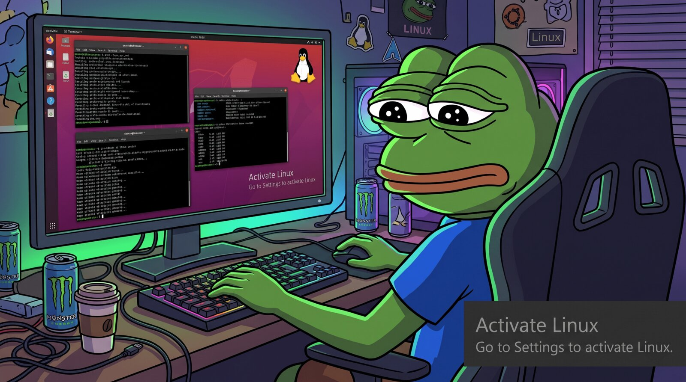

# Activate Linux Watermark

**The Windows activation nag, now on Linux.**

## Features

- **Every monitor**: one watermark per screen, follows hot-plugging
- **Out of your way**: transparent, click-through, always on top
- **Tiny**: ~550 KB binary, ~12 MB RAM, ~0% CPU
- **Customizable**: text, font sizes, margins and opacity, applied live
- **Bouncing mode**: drifts around and bounces off the edges like the DVD logo
- **Works everywhere**: X11 and Wayland (via XWayland), `.deb` and `.rpm`
- **Starts at login**, and is removed cleanly on uninstall

## Install

Download the package from [Releases](https://github.com/theld21/activate-linux-watermark/releases):

    sudo dnf install ./activate-linux-watermark-*.x86_64.rpm   # Fedora / RHEL
    sudo apt install ./activate-linux-watermark_*_amd64.deb    # Ubuntu 22.04+ / Debian 12+

It starts automatically at login. To start it now, open **Activate Linux Watermark** from your app list.

## Configure

Open **Activate Linux Watermark** from your app list to turn it on/off, edit both lines, font sizes, margins, opacity, or turn on **Bouncing watermark**.
Changes apply instantly. Config file: `~/.config/activate-linux-watermark.conf`.

## Uninstall

    sudo dnf remove activate-linux-watermark   # or: sudo apt remove activate-linux-watermark

## Build

    cargo install cargo-deb cargo-generate-rpm
    cargo build --release && cargo deb --no-build && cargo generate-rpm

## Release

Bump `version` in `Cargo.toml`, then `git tag vX.Y.Z && git push --tags`.
GitHub Actions builds the `.deb` and `.rpm` and attaches them to the release.
